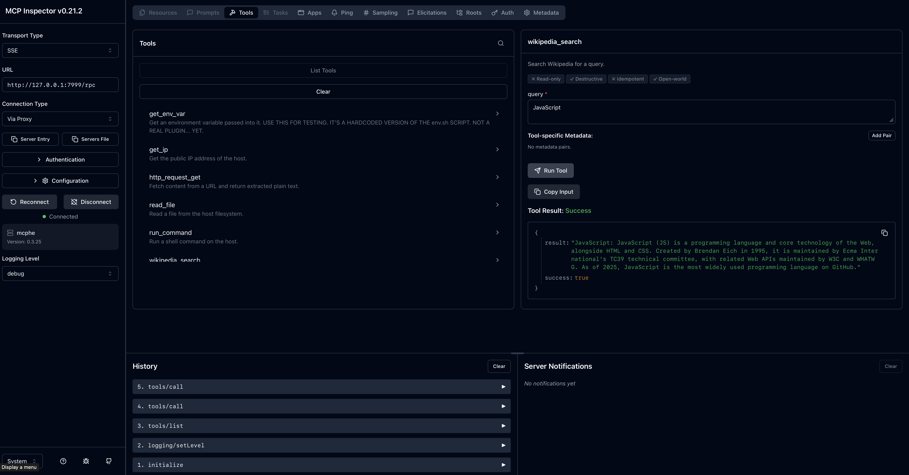

# MCP Host Engine (Go + JavaScript Plugins) Server


This repository contains a Go-based MCP server that runs tools as JavaScript plugins.  This allows versitility for the MCP server as many servers are product specific requiring one for GitHub, one for Google Docs, etc.  This allows you to plugin only what you need to create your own custom server  as a service  to be used by LLMs, AI agents, etc.  You can run the server on your local machine or on a remote server, and you can also run it as a Docker container.

## Features

- JSON-RPC 2.0 `/rpc` endpoint
- Pluggable tool support via `plugins/*.js`
- Configurable host, port, bearer auth, allowed domains, and enabled tools
- Built-in host APIs exposed to plugins (Namespaced modules: `host.fs`, `host.http` (with PATCH support), `host.exec`, `host.process`, `host.path`, `host.crypto`, `host.console`, `host.sleep`, `host.url`, `host.utils`)

## Install

Every release publishes the same artifacts from a single build, so use whichever suits your platform. The examples below use `0.5.80`; substitute the version you want. All of them download from:

```text
https://github.com/davidcrumpton/mcp-host-engine/releases/download/v<version>/
```

| Artifact | For |
| :--- | :--- |
| `mcphe_<version>_linux_<arch>.deb` / `.rpm` / `.apk` | Debian/Ubuntu, Fedora/RHEL, Alpine |
| `mcp-host-engine_<version>_linux_<arch>.tar.gz` | any Linux |
| `mcp-host-engine_<version>_darwin_<arch>.tar.gz` | macOS (amd64, arm64) |
| `mcp-host-engine_<version>_windows_<arch>.zip` | Windows |
| `*.sbom.json` | SPDX SBOM for the matching archive |
| `checksums.txt` + `checksums.txt.sigstore.json` | verify what you downloaded |
| `ghcr.io/davidcrumpton/mcp-host-engine:<version>` | container image, amd64 + arm64 |

Packages install the binary to `/usr/local/bin/mcphe`, the plugins to `/usr/share/mcphe/plugins/`, and an example config to `/etc/mcphe/config.yaml` (registered as a conffile, so upgrades will not overwrite your edits).

### Homebrew (macOS and Linuxbrew)

```bash
brew install davidcrumpton/tap/mcphe
```

The formula installs the binary, the plugins to `$(brew --prefix)/share/mcphe/plugins`, and a config to `$(brew --prefix)/etc/mcphe/config.yaml` whose `plugin_dir` is rewritten to match. Homebrew never overwrites an existing config, so your edits survive upgrades.

```bash
"${EDITOR:-vi}" "$(brew --prefix)/etc/mcphe/config.yaml"   # 1. set token_secret
mcphe token create alice 30d                              # 2. mint a bearer token
mcphe "$(brew --prefix)/etc/mcphe/config.yaml"            # 3. start on 127.0.0.1:8001
```

The formula is pushed to the tap by the release workflow, which needs the `TAP_GITHUB_TOKEN` secret — see [Releasing](#releasing). If that secret is missing the release still succeeds and only the formula is skipped.

### Debian / Ubuntu

```bash
ver=0.5.80; arch=amd64            # or arm64
curl -LO "https://github.com/davidcrumpton/mcp-host-engine/releases/download/v${ver}/mcphe_${ver}_linux_${arch}.deb"
sudo apt install "./mcphe_${ver}_linux_${arch}.deb"
```

### Fedora / RHEL

```bash
ver=0.5.80; arch=amd64
curl -LO "https://github.com/davidcrumpton/mcp-host-engine/releases/download/v${ver}/mcphe_${ver}_linux_${arch}.rpm"
sudo dnf install "./mcphe_${ver}_linux_${arch}.rpm"
```

### Alpine

```bash
ver=0.5.80; arch=amd64
curl -LO "https://github.com/davidcrumpton/mcp-host-engine/releases/download/v${ver}/mcphe_${ver}_linux_${arch}.apk"
sudo apk add --allow-untrusted "./mcphe_${ver}_linux_${arch}.apk"
```

> The `.apk` is not signed by an Alpine key, hence `--allow-untrusted`. Verify the download with `checksums.txt` (below) before installing if that matters to you.

### Tarball / zip (any platform)

```bash
ver=0.5.80
curl -LO "https://github.com/davidcrumpton/mcp-host-engine/releases/download/v${ver}/mcp-host-engine_${ver}_linux_amd64.tar.gz"
mkdir -p "mcphe-${ver}" && tar -xzf "mcp-host-engine_${ver}_linux_amd64.tar.gz" -C "mcphe-${ver}"
cd "mcphe-${ver}"    # the archive is flat: mcphe, plugins/, config.example.yaml, README.md, LICENSE

# either run it in place...
./mcphe config.example.yaml
# ...or install it system-wide, matching the layout the packages use
sudo install -m 0755 mcphe /usr/local/bin/
sudo mkdir -p /usr/share/mcphe && sudo cp -r plugins /usr/share/mcphe/
sudo mkdir -p /etc/mcphe && sudo cp config.example.yaml /etc/mcphe/config.yaml
```

The shipped `config.example.yaml` sets `plugin_dir: /usr/share/mcphe/plugins`, which matches the package layout. Running from the extracted directory instead? Change it to `plugin_dir: plugins`.

### Container image

```bash
docker run --rm -p 8001:8001 \
  -e MCPHE_TOKEN_SECRET="$(openssl rand -hex 32)" \
  -e MCPHE_REVOKE_FILE=/tmp/revocations.yaml \
  ghcr.io/davidcrumpton/mcp-host-engine:0.5.80
```

Both `-e` variables are **required** by the image's default config: they are `env://` references, and an unresolved `env://` is fatal at startup. Omit them and the container exits with `Failed to load config: resolving field "TokenSecret"`. The revocation file does not have to exist — a missing file means "nothing revoked".

For stdio mode (MCP clients that spawn a process), pass the stdio config instead; it needs neither variable:

```bash
docker run -i --rm ghcr.io/davidcrumpton/mcp-host-engine:0.5.80 /etc/mcphe/config.stdio.yaml
```

See `deploy/README.md` for compose, bind-mounting plugins, and building your own image.

### Verify a download

`checksums.txt` covers every asset, and it is signed with keyless cosign, so you can check both integrity and provenance without a public key to manage:

```bash
# 1. Checksums (only the files you actually downloaded need to be present)
sha256sum --ignore-missing -c checksums.txt      # Linux
shasum -a 256 -c --ignore-missing checksums.txt  # macOS

# 2. Signature over checksums.txt
cosign verify-blob --bundle checksums.txt.sigstore.json \
  --certificate-identity-regexp '^https://github.com/davidcrumpton/mcp-host-engine/' \
  --certificate-oidc-issuer https://token.actions.githubusercontent.com \
  checksums.txt

# 3. Build provenance (SLSA), if you use the GitHub CLI
gh attestation verify mcphe_0.5.80_linux_amd64.deb \
  --repo davidcrumpton/mcp-host-engine
```

### First run after installing

The packages and tarball ship with an empty `token_secret` so that no credential is baked into a downloadable artifact. Set one, then mint a token:

```bash
sudo "${EDITOR:-vi}" /etc/mcphe/config.yaml     # set token_secret
mcphe token create alice 30d                     # prints a bearer token
mcphe /etc/mcphe/config.yaml                     # start on 127.0.0.1:8001
```

`token create` takes positional arguments (`<username> <duration> [label]`), and any flags must come before them. To avoid keeping the secret on disk, point `token_secret` at `env://MCPHE_TOKEN_SECRET` or a `vault://` path instead — see [Resolving YAML Config Values](#resolving-yaml-config-values).

## Run from source

1. Install dependencies and build:

```bash
go mod tidy
make build
```

2. Create tokens if using `token_secret` in config:

```bash
mcphe token create <username> <duration>
# ensure application uses token in Bearer field in header.
```

3. Start the server:

```bash
./mcphe config.yaml
```

4. Call the server via POST to `http://127.0.0.1:8001/rpc`.

## Configuration File Reference (`config.yaml`)

This section details the available settings for the MCP Host Engine. These values can be overridden in your `config.yaml` file to customize the server's behavior, network binding, and plugin security policies.

---

### Basic Server Settings

| Key | Type | Default | Description |
| :--- | :--- | :--- | :--- |
| `transport` | `string` | `"http"` | The transport to use for the MCP Host Engine.  Must be `"http"` or `"stdio"`. |
| `port` | `string` | `"8001"` | The network port the MCP Host Engine will listen on. |
| `host` | `string` | `"127.0.0.1"` | The network interface to bind the server to. Use `"0.0.0.0"` to listen on all interfaces. |
| `use_https` | `bool` | `false` | If set to `true`, the server will enforce HTTPS communication. |
| `cert_file` | `string` | *(none)* | Path to the SSL certificate file required when `use_https` is `true`. |
| `key_file` | `string` | *(none)* | Path to the private key file required when `use_https` is `true`. |
| `token_secret` | `string` | *(none)* | A shared secret used to sign and verify JWT tokens. All clients and servers must use the same secret. |
| `token_revocation_file` | `string` | *(none)* | Path to the file containing revoked tokens. |
| `bearer_token` | `string` | *(none)* | Obsolete in future releases.  This is the static API key/token used for authenticating external client requests.  It will be replaced by tokens signed with the `token_secret`. |
| `pid_file` | `string` | *(none)* | The file path where the server's Process ID (PID) will be written upon startup. This is useful for process management. |
| `vault_addr` | `string` | *(none)* | The address of the Vault server.  This is required if you are using `vault://` scheme in your config. |
| `vault_token` | `string` | *(none)* | The token to use for authentication with Vault but you should use approle instead. |
| `vault_role_id` | `string` | *(none)* | The role ID to use for authentication with Vault approle. |
| `vault_secret_id` | `string` | *(none)* | The secret ID to use for authentication with Vault approle. |
| `vault_approle` | `string` | *(none)* | The approle to use for authentication with Vault.  This is the mount point for the approle. |

### Resolving YAML Config Values

Support for values from vault, env, or file are provided for any config values which relieves the JavaScirpt plugin of having to do it and reduces the attack surface area of the plugin by not needing approvals defined in the config file.  Plugin authors are still capable of using host functions to get values from env variables or read/write files.  That will still require explicit config file plugin approvals.  The format is:

```yaml
<value>: "<scheme>://<path>"
```

where scheme is `vault`, `env`, or `file`.

The values are resolved in the following order:

1. `vault://<mount-point>/<path>` - The value is read from `vault`.
2. `env://<ENV_VAR>` - The value is read from the environment variable `ENV_VAR`.
3. `file:///path/to/file` - The value is read from a file.

For the "vault://" scheme, the value is read from `vault` using the `path` to get the secret, and the `key` (everything after "#") to get the specific field from the secret.  The `path` should be the path to the secret in `vault`.  The `key` should be the key of the secret in `vault`.

example:

```yaml
plugins:
  get_ip:
    api_key: "vault://secret/data/db#password"
    ip_host: "env://IP_HOST"
    mime_types: "file:///etc/mcphe/mime_types.yaml"
    allowed_domains: ["ifconfig.io"]
    allowed_http_methods:
      - "GET"
```

If you want to use a comma separated list of values, you can use the `splitListValue` function.

```yaml
plugins:
  get_ip:
    api_key: "vault://secret/data/db#password"
    ip_host: "env://IP_HOST"
    mime_types: "file:///etc/mcphe/mime_types.yaml"
    allowed_domains: splitListValue("env://ALLOWS_IP_DOMAINS")
    allowed_http_methods:
      - "GET"
```

### Resolvable Top Level Fields

Common sense must prevail.  You can't resolve `vault_addr` with `vault://` before the vault system is initialized but you can resolve `vault_addr` with an environment variable or file contents.  If `vault_addr` is not set, Vault cannot be initialized and the `vault://` scheme will not be registered. Note that `env://` and `file://` are always registered and usable for all top level fields defined below.  MCPHE doesn't do any sanity checking or error handling for this.  If it's not there, it's not there and you'll get an error later on.

MCPHE doesn't support nesting `my_yaml_var: vault://Some/Vault/Path/secret#env://MY_SECRET`.  It will only resolve the leftmost scheme passing the entire string to vault as the path which won't work since the env:// part isn't in vault.  Same is true for file://.

The following top level fields are resolvable using `vault://`, `env://`, or `file://` schemes:

```text
"bearer_token",
"token_secret",
"token_revocation_file",
"pid_file",
"vault_addr",
"vault_token",
"vault_role_id",
"vault_secret_id",
"vault_approle",
```

### Plugin and Tool Management

These settings control which plugins are available and what level of access they have.  Note that plugins are loaded at startup and are not dynamically reloadable.  If you change the plugins directory, you will need to restart the server.  If you change any of the other plugin settings, you will need to restart the server for the changes to take effect.  I

| Key | Type | Default | Description |
| :--- | :--- | :--- | :--- |
| `plugin_dir` | `string` | `"plugins"` | The local directory where the engine expects to find all JavaScript plugin files. |
| `plugins` | `map[string]map[string]interface{}` | *See Example* | Provides fine-grained, plugin-specific security and domain restrictions. The top-level key is the plugin name. |

### Security and Logging

| Key | Type | Default | Description |
| :--- | :--- | :--- | :--- |
| `verbosity_level` | `int` | `0` | The minimum logging level required for a message to be printed. Higher numbers mean more detailed logging (e.g., `3` might mean DEBUG level). |

---

### Advanced Plugin Restrictions (`plugins` Map)

The `plugins` map allows administrators to restrict the capabilities of individual plugins, enhancing security.

**Structure:**

```yaml
plugins:
  <plugin_name>:
    # Restrictions for this specific plugin
    enabled: true  # defaults true if defined at all. false if explicitly set to false. Remove it or false to disable
    allowed_domains: [...]
    allowed_write_file_paths: [...]
    allowed_read_file_paths: [...]
    allowed_commands: [...]
    allowed_env_vars: [...]
```

#### Detailed Restrictions

1. **`enabled`**:
   * **Type:** `boolean`
   * **Default:** `true` if the plugin is defined in the `plugins` map, `false` otherwise.
   * **Purpose:** Explicitly enables or disables a plugin. If `false`, the plugin will not be loaded or available to the MCP server.
   * **Example:**

     ```yaml
     plugins:
       my_plugin:
         enabled: false
     ```

2. **`allowed_domains`**:
    * **Type:** `list<string>`
    * **Purpose:** Restricts which domains a plugin (like `wikipedia_search` or `google_search`) is allowed to connect to via HTTP requests.
    * **Example:**

        ```yaml
        plugins:
          wikipedia_search:
            allowed_domains: ["en.wikipedia.org"]
        ```

3. **`allowed_write_file_paths`**:
    * **Type:** `list<string>`
    * **Purpose:** A list of absolute paths where the plugin is *permitted* to write files. If a path is not listed, writing to it will fail.
    * **Example:**

        ```yaml
        plugins:
          my_tool:
            allowed_write_file_paths: ["/tmp/output/"]
        ```

4. **`allowed_read_file_paths`**:
    * **Type:** `list<string>`
    * **Purpose:** A list of absolute paths where the plugin is *permitted* to read files.
    * **Example:**

        ```yaml
        plugins:
          data_processor:
            allowed_read_file_paths: ["/mnt/data/input.csv"]
        ```

5. **`allowed_commands`**:
    * **Type:** `list<string>`
    * **Purpose:** Limits the commands that a plugin can execute via the `runCommand` method. Each item in the list should be a full command string (e.g., `"ls -l /tmp"`).
    * **Example:**

        ```yaml
        plugins:
          os_utility:
            allowed_commands: ["ls -l", "pwd"]
        ```

6. **`allowed_env_vars`**:
    * **Type:** `list<string>`
    * **Purpose:** Specifies which environment variables the plugin is allowed to access via `getEnv`.
    * **Example:**

        ```yaml
        plugins:
          api_client:
            allowed_env_vars: ["API_KEY", "USER_ID"]
        ```

### Plugin Required Modules

Available built-in modules:

- fs
- http
- path
- crypto
- console
- sleep
- url
- utils

### Example Plugin Code

```javascript
// plugins/test_plugin.js
const { runCommand, http, fs, path, crypto, console, sleep, url, utils } = require('./lib/all.js');

module.exports = {
  name: "test_plugin",
  description: "A simple test plugin.",
  inputSchema: { type: "object", properties: {}, required: [] },
  call(params) {
    return "pong";
  }
};
```

---

### Example Usage

Here is an example demonstrating how to configure a dedicated analytics plugin (`analytics_reporter`) while keeping the built-in tools restricted.

```yaml
# config.yaml
port: "8080"
host: "127.0.0.1"
use_https: false
bearer_token: "super-secure-mcp-token"
plugins:
  # Security overrides for built-in tools
  wikipedia_search:
    allowed_domains: ["en.wikipedia.org"]
  
  google_search:
    allowed_domains: ["google.com"]
  
  # Custom plugin definition
  analytics_reporter:
    allowed_write_file_paths: ["/var/log/mcp_reports/"]
    allowed_read_file_paths: ["/app/data/metrics.csv"]
    allowed_commands: ["date"] # Only allow the 'date' command
    allowed_env_vars: ["REPORTING_ENV"]


## Plugin development

Create a JavaScript plugin in `plugins/` with `module.exports = { name, description, inputSchema, call }`.
The `call` function receives the JSON arguments object and may return a string, object, array, or primitive.

Example tool:

```js
module.exports = {
  name: "ping",
  description: "A simple ping/pong tool for testing.",
  inputSchema: { type: "object", properties: {}, required: [] },
  call(params) {
    return "pong";
  }
};
```

## Token Management

```bash
❯ mcphe token 
Usage:
  mcphe token create [-config path] <username> <duration> [label]
  mcphe token revoke [-config path] <username>[:<label>] [ttl]
  duration/ttl examples: 12h, 30d, 1y  (flags must come before positional args)
```

Combine with `token_secret` for signing and revoking tokens.  Output a token to be used in the MCP Server's `Authorization: Bearer <token>` header field.

## Caveats

This was designed and tested with `gemma-4-31b` , `gemma-4-26b-a4b-it`, `gemma4:e2b` and many others including Qwen models.
I have had no issues with MCP HE working with OpenWebUI 0.9.X editions or later, LMStudio, MCP Inspector.

The n8n platform does not work at this time. It can login and see tools but fails to call them, for unknown reasons.

MCP Application support is currently in early stages and may not work with all applications. It functions well in MCP Inspector as pictured below.

## Releasing

Releases are cut from a tag, and only from a tag. `.github/workflows/go.yml` builds and tests on every push; `.github/workflows/release.yml` publishes, and it runs only for `v*`.

```bash
echo 0.5.81 > VERSION
git commit -am "chore: release 0.5.81"
git push github main

git tag v0.5.81
git push github v0.5.81        # <- this triggers the release
```

The tag must match the `VERSION` file. `make build` stamps `VERSION` into a local binary while GoReleaser stamps the tag, so if they disagree a locally built binary reports a different version than the release it came from. The workflow checks this first and fails before building anything.

`make snapshot` builds every artifact locally without publishing (it skips the image, SBOMs and signing, which need a registry and an OIDC identity).

### After the release

A green workflow does not mean the release works: `v0.5.82` published successfully and installed a binary that could not find a single plugin. Verify the artifacts, not just the pipeline.

```bash
# 1. the tap picked up the new version
curl -sL https://raw.githubusercontent.com/davidcrumpton/homebrew-tap/main/Formula/mcphe.rb | grep '^  version'

# 2. a clean install finds its plugins (force the untap, see TAP_GITHUB_TOKEN)
brew uninstall --force mcphe
brew untap --force davidcrumpton/tap
brew install davidcrumpton/tap/mcphe
grep '^plugin_dir' "$(brew --prefix)/etc/mcphe/config.yaml"   # must not contain Cellar
ls "$(brew --prefix)/opt/mcphe/share/mcphe/plugins/"*.js | wc -l
```

Then start it and confirm the plugin count matches the tracked plugins:

```bash
"${EDITOR:-vi}" "$(brew --prefix)/etc/mcphe/config.yaml"   # set token_secret
mcphe "$(brew --prefix)/etc/mcphe/config.yaml"
```

### TAP_GITHUB_TOKEN

The release pushes `Formula/mcphe.rb` into the separate **`davidcrumpton/homebrew-tap`** repository. The workflow's own `GITHUB_TOKEN` is scoped to this repository and cannot write to another one, so the tap needs a personal access token supplied as a secret named `TAP_GITHUB_TOKEN`.

**1. Create a fine-grained token**

Open <https://github.com/settings/personal-access-tokens/new> and set:

| Field | Value |
| :--- | :--- |
| Token name | `mcphe release -> homebrew-tap` |
| Resource owner | `davidcrumpton` |
| Expiration | anything you will remember to renew |
| Repository access | **Only select repositories** → `davidcrumpton/homebrew-tap` |
| Repository permissions → **Contents** | **Read and write** |
| Repository permissions → Metadata | *Read-only* (added automatically) |

Nothing else is required — no Actions, no Workflows, no admin. Restricting it to the tap means a leaked token cannot touch this repository.

**2. Add it to this repository**

```bash
gh secret set TAP_GITHUB_TOKEN --repo davidcrumpton/mcp-host-engine
# paste the token (github_pat_...) at the prompt
```

Or by hand: this repo → **Settings** → **Secrets and variables** → **Actions** → **New repository secret**, name `TAP_GITHUB_TOKEN`, value = the token.

**3. Confirm it took effect**

Confirmed working as of `v0.5.83`: the release log contains no `TAP_GITHUB_TOKEN is not set` warning and `Formula/mcphe.rb` appears in the tap. To check the secret exists without cutting a release:

```bash
gh secret list --repo davidcrumpton/mcp-host-engine | grep TAP_GITHUB_TOKEN
```

Note that the tap clone on your machine is a cache. `brew untap` **silently does nothing** while a formula from that tap is installed, so re-installing can read a stale formula — the trap that made a `v0.5.83` install fetch the `v0.5.82` keg. Force it when you need a fresh read:

```bash
brew uninstall --force mcphe
brew untap --force davidcrumpton/tap
```

`untap --force` also **uninstalls every other formula from that tap** — currently `tokenmgr` and `mcwsd`. Reinstall them afterwards, or use a scratch tap for the check instead.

Notes:

- **If the secret is absent** the release still succeeds and logs a warning; only the formula is skipped. That is why `v0.5.80` shipped without one.
- **If the secret is present but invalid or expired** the release fails at the Homebrew step, because GoReleaser treats a failed push as fatal. Rotate it before it expires.
- A classic PAT with `repo` scope also works, but that grants write access to *every* repository you own. Prefer the fine-grained token above.
- The container image needs no extra secret: it pushes to `ghcr.io` with `GITHUB_TOKEN` and the workflow's `packages: write` permission.

## Development

To build and deploy a container, see `deploy/README.md`. One image runs in both modes — `transport: http` (HTTP daemon on `/rpc`) or `transport: stdio` — chosen at run time by the config file it is given, so plugin changes never require a rebuild:

```bash
cp deploy/.env.example deploy/.env && $EDITOR deploy/.env   # secrets + per-plugin creds

docker compose up -d --build            # HTTP daemon
docker compose run --rm -T mcphe-stdio  # stdio, for an MCP client
```

Without compose (Apple `container` CLI), `./deploy/run.sh build|http|stdio|logs|stop` does the same thing with the same files. To run the server locally, see `tests/README.md` for instructions on building and running the server locally.

